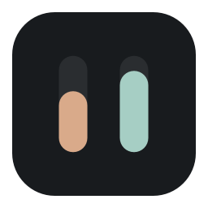
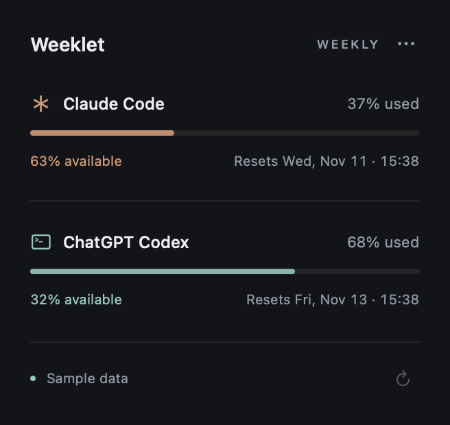
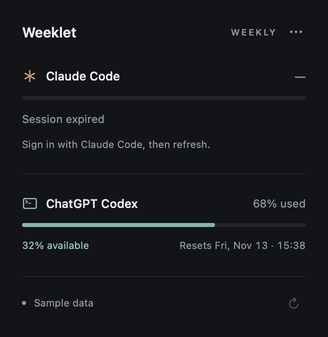

<p align="center">
  
</p>
<h1 align="center">Weeklet</h1>
<p align="center"><strong>Your AI week, at a glance.</strong></p>
<p align="center">A tiny native macOS menu bar app for Claude Code and ChatGPT Codex quotas.</p>
<p align="center"><sub>macOS 14+ · Swift 6 · Always dark · Zero third-party runtime dependencies</sub></p>

<p align="center">
  <a href="#get-started">Get started</a> ·
  <a href="#screenshots">Screenshots</a> ·
  <a href="docs/privacy.md">Privacy</a> ·
  <a href="docs/architecture.md">Architecture</a> ·
  <a href="docs/validation.md">Validation</a>
</p>

---

Weeklet keeps two numbers close: how much of your **weekly Claude Code and Codex quotas is still available**. No dashboard to babysit. No extra sign-in. Click the menu bar to see used and available percentages, a quiet progress bar and the next reset.

**Weeklet** combines *week* and *applet*: a small place for your AI week.

## Screenshots

<p align="center">
  
  &nbsp;&nbsp;
  
</p>
<p align="center"><sub>Rendered from the native SwiftUI interface. All values are sample data; no account data is published.</sub></p>

## Quiet by design

| | |
| --- | --- |
| **One glance** | `C 63% · X 32%` in the menu bar. Available quota, in Claude / Codex order. |
| **One small popover** | Used and available percentages, weekly bars and reset dates in local time. |
| **A light footprint** | Native status item and SwiftUI. One five-minute refresh timer, no embedded browser. |
| **Your existing sign-in** | Read-only access to the official tools' local credentials. No copied or renewed tokens. |
| **Clear failure states** | Expired session, offline, denied access, rate limited or unavailable quota. No invented numbers. |
| **Your choice at login** | Optional launch at login using Apple's ServiceManagement framework. |

The popover is always dark and all app text is English. macOS controls the system menu bar's appearance. There is no Dock icon or permanent app window.

## Get started

You need **macOS 14 or later**, **Swift 6.0 or later**, and an existing subscription sign-in in Claude Code and/or Codex. Xcode or Apple's Command Line Tools is sufficient; no package downloads are needed.

```sh
git clone https://github.com/mgalli97/weeklet.git
cd weeklet
./scripts/test.sh
./scripts/build.sh
open "build/Weeklet.app"
```

The build script produces an optimized application bundle with an original icon and a local ad-hoc signature. Open `Package.swift` in Xcode to edit or debug.

For launch at login, move the app to `/Applications` or `~/Applications`, then enable **Options → Launch at login**. macOS may request approval in **System Settings → General → Login Items**. The option uses the operating system's actual registration state; Weeklet does not enable it automatically.

<details>
<summary><strong>Universal builds and signing</strong></summary>

```sh
./scripts/build.sh --arch arm64 --arch x86_64
```

Set `SIGNING_IDENTITY` to use your own signing identity. A raw `swift run` works for development, but login-item registration requires the `.app` bundle. Distribution to other Macs requires your own Developer ID signature and Apple notarization. The included local build is **not notarized**; rebuilding an ad-hoc signed app may require granting Keychain access again.

</details>

## Refresh, without surprises

Weeklet refreshes on launch, approximately every **five minutes** and after waking when due. Click Refresh or press **⌘R** for a manual check. Rapid clicks are throttled, and a provider's `Retry-After` is honored.

A dash in the menu bar means the current quota is unavailable. On a network failure, the popover may keep a clearly marked **Last known** value. Values become outdated after ten minutes or when their reset passes. Weeklet never assumes a missing quota is zero or unlimited, or that a reset has already restored your allowance.

These are the **all-model weekly subscription quotas**. Individual models, code review, credits and ChatGPT web messages can have separate limits. Weeklet does not combine those buckets.

## Private, by construction

- Reads an existing official-tool session from a narrowly scoped Keychain item or credential file.
- Makes `GET` requests only to the two fixed provider HTTPS usage endpoints.
- Refuses every redirect. Keeps system TLS validation enabled.
- Never refreshes, modifies, saves or logs tokens. Never launches a provider CLI or reads browser cookies.
- No backend, analytics, telemetry, updater, credential database or third-party runtime packages.

Background refresh cannot show a Keychain access dialog. If access is denied, unlock Keychain and click Refresh for a foreground read. If a session expires, renew it in the official tool and refresh Weeklet.

Read the precise [credential locations and privacy boundaries](docs/privacy.md) and [security policy](SECURITY.md). Custom-directory Claude Keychain-only sessions, API-key-only sessions and externally held credentials are currently unsupported.

## Verification status

The optimized Apple Silicon app builds on **macOS 26.7.1 with Swift 6.3.3**, using standalone Command Line Tools. **38 isolated tests pass** across contracts, credentials, transport behavior and refresh state.

A real Codex usage request succeeded. The existing Claude credential was expired, so a successful authenticated Claude response remains unverified. Its parsers are covered by synthetic fixtures and provider contract observations. Interactive popover behavior, login-item registration and Intel execution still need manual verification. See the full [validation record](docs/validation.md).

Provider usage endpoints are **internal contracts**, not stable public APIs. The app reports an explicit error if a provider changes or rejects them. See [contract evidence](docs/provider-contracts.md).

## Preview and diagnostics

```sh
# Sample data only; no credential reads or provider requests.
open "build/Weeklet.app" --args --preview

# Real, read-only usage check with sanitized output.
"build/Weeklet.app/Contents/MacOS/Weeklet" --check

# Permit a macOS Keychain dialog for this foreground check.
"build/Weeklet.app/Contents/MacOS/Weeklet" --check --allow-keychain

# Regenerate the README's native interface previews from sample data.
./scripts/screenshots.sh
```

`--check` exits 0 only when both providers report a weekly quota. `--snapshot` always uses sample data; add `--sample-errors` to preview the expired-session state. Never pass tokens as command-line arguments.

## Inside Weeklet

SwiftUI + AppKit is a better fit for this Mac-only utility than Rust/Tauri: native status-item, popover, Keychain and login-item APIs, without an embedded browser or cross-language bridge. The application code was written from scratch; no competitor implementation was copied.

| Documentation | What it covers |
| --- | --- |
| [Architecture](docs/architecture.md) | Data flow, modules, concurrency, resource use and native design choices |
| [Privacy and credentials](docs/privacy.md) | Supported stores, path overrides, read-only access and limitations |
| [Provider contracts](docs/provider-contracts.md) | Endpoints, field units, live observations and compatibility boundaries |
| [Validation](docs/validation.md) | Build, tests, live checks and remaining manual verification |
| [Contributing](CONTRIBUTING.md) | Local workflow, fixture rules and review expectations |
| [Security](SECURITY.md) | Threat boundaries and private reporting guidance |

A [manually triggered macOS workflow](.github/workflows/verify.yml) is included for repeatable verification. It needs no provider credentials and does not automatically consume hosted macOS runner minutes on each push.
