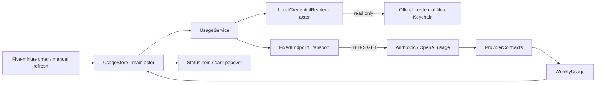

# Architecture

Weeklet uses Swift 6, SwiftUI and AppKit, targeting macOS 14 or later. There are no third-party runtime dependencies.

## Why native

A menu bar app needs a status item, a transient popover, a secure credential read and an optional login item. AppKit, SwiftUI, Security and ServiceManagement provide each directly. Rust/Tauri would introduce a web runtime and a cross-language bridge for a small amount of UI and two network calls. Native code keeps the lifecycle and dependency surface smaller.

## Data flow

## Modules

| Component | Responsibility |
| --- | --- |
| `WeekletCore/Usage.swift` | Normalized quota, safe failure messages and freshness rules |
| `Credentials.swift` | Read-only file and Keychain access; transient access-token parsing |
| `ProviderContracts.swift` | Isolated provider wire formats and all-model weekly selection |
| `UsageService.swift` | Fixed request construction, bounded transport and sanitized HTTP handling |
| `UsageStore.swift` | Independent concurrent refreshes, coalescing, throttling and backoff |
| `Weeklet/AppDelegate.swift` | Accessory application, `NSStatusItem`, `NSPopover`, wake notification |
| `PopoverView.swift` | Compact English-only SwiftUI presentation |
| `LoginItemController.swift` | Optional registration through `SMAppService.mainApp` |

## Concurrency and resources

The UI model is main-actor isolated. Credential reads run on a separate actor; the transport uses asynchronous URLSession APIs. Providers complete independently in a structured task group. Overlapping refreshes are coalesced, rapid manual clicks are throttled, and HTTP `Retry-After` applies to both manual and automatic attempts.

There is one five-minute timer with 20 seconds of tolerance. It does not wake a sleeping Mac. A wake notification checks whether a refresh is due. There is no filesystem polling, embedded web runtime, conversation parsing, helper process or persistent network connection. Spinners appear only while a refresh is in flight.

Usage lives in memory. On network failure, the popover can retain a clearly marked last known value; the menu bar shows a dash. Credential failures clear the prior value. A fetched value is also outdated after ten minutes or after its reported reset. A missing weekly quota is never interpreted as zero use or unlimited access.

## Preview rendering

`--snapshot` renders the real SwiftUI popover with synthetic data using `ImageRenderer`. Because AppKit menu controls cannot be rasterized by that renderer, the preview renders the options control's identical ellipsis label. `--sample-errors` selects a synthetic expired-session state. Neither path reads credentials or requests provider data. Screenshots are intentionally labeled **Sample data**.

## Build and distribution

SwiftPM is the source of truth. The build script assembles the `.app`, includes `LSUIElement` metadata and an original icon, and applies a local ad-hoc signature. There is no Dock icon or normal app window. A Developer ID signature and notarization are separate distribution steps and are not supplied by this repository.
