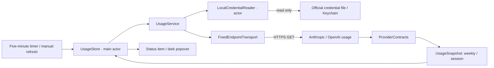

# Architecture

Weeklet uses Swift 6, SwiftUI and AppKit, targeting macOS 14 or later. There are no third-party runtime dependencies.

## Why native

A menu bar app needs a status item, a transient popover, a secure credential read and an optional login item. AppKit, SwiftUI, Security and ServiceManagement provide each directly. Rust/Tauri would introduce a web runtime and a cross-language bridge for a small amount of UI and two network calls. Native code keeps the lifecycle and dependency surface smaller.

## Data flow

## Modules

| Component | Responsibility |
| --- | --- |
| `WeekletCore/Usage.swift` | Independent quota windows, safe failure messages and freshness rules |
| `Credentials.swift` | Read-only file and Keychain access; transient access-token parsing |
| `ProviderContracts.swift` | Isolated provider wire formats and weekly and Claude session selection |
| `UsageService.swift` | Fixed request construction, bounded transport and sanitized HTTP handling |
| `UsageStore.swift` | Independent concurrent refreshes, coalescing, throttling and backoff |
| `Weeklet/AppDelegate.swift` | Accessory application, `NSStatusItem`, `NSPopover`, wake notification |
| `PopoverView.swift` | Compact English-only SwiftUI presentation |
| `LoginItemController.swift` | Optional registration through `SMAppService.mainApp` |
| `Activity.swift`, `LocalActivityReader.swift`, `ActivityStore.swift` | Local read-only lifecycle detection, short titles, cached file tails and conditional pulse |
| `ProviderArtwork.swift` | Local provider-owned logos, popover images and native menu bar attachments |

## Concurrency and resources

The UI model is main-actor isolated. Credential reads run on a separate actor; the transport uses asynchronous URLSession APIs. Providers complete independently in a structured task group. Overlapping refreshes are coalesced, rapid manual clicks are throttled, and HTTP `Retry-After` applies to both manual and automatic attempts.

Quota refresh uses one five-minute timer with 20 seconds of tolerance, plus a wake notification when a refresh is due. A separate bounded local-activity check runs every five seconds, caching index and file modification stamps. A pulse timer runs only while work is active. There is no embedded web runtime, helper process or persistent network connection. Timers do not wake a sleeping Mac; spinners appear only during refresh.

When a fresh window displays less than 20% available allowance and has a future reported reset, its status-item value includes a compact countdown, for example `19% h (2h lft)`. The same 11-point font applies to the whole label. A local one-minute timer with two seconds of tolerance exists only while at least one such countdown is visible, and is invalidated when no countdown is eligible. It only reformats in-memory timestamps; the provider request cadence is unchanged. A wake notification also updates the title immediately. Counts round up to whole minutes or hours, use `<1m lft` for the final minute, and never invent an unknown reset or restored allowance. Weekly and session countdowns remain independent.

Usage lives in memory. On network failure, the popover can retain a clearly marked last known value; the menu bar shows a dash. Credential failures clear the prior value. A fetched value is also outdated after ten minutes or after its reported reset. A missing weekly quota is never interpreted as zero use or unlimited access. `UsageSnapshot` keeps optional weekly and session `QuotaUsage` values separate; freshness is evaluated per window. The status item labels Claude's session and weekly availability with `h` and `w`, while Codex shows `w`. Missing or stale windows have independent dashes. Both Claude values come from the same HTTPS response, adding no extra polling or requests.

## Provider visibility and Help

`ProviderState.isVisible` derives presentation from the current result without storing a provider preference or credential. Unknown initial states and missing, expired, unsupported, inaccessible or unsafe sign-ins are hidden. A completed usage request with a temporary failure remains visible, preserving an explicit error instead of treating connectivity loss as sign-out. `UsageStore.visibleStates` drives both quota rows and the status item; separators, activity labels and countdowns are limited to those visible providers. When no provider is visible, a Weeklet icon preserves access to Options and setup.

Filtering is presentation-only: refresh continues to check all providers, including hidden ones, so official-tool sign-in is discovered by a manual or scheduled refresh. Options → Help switches the same popover to a compact setup view with official sign-in commands, copy buttons, the latest provider errors and Refresh/Done controls. Nothing is launched, authenticated or persisted by the Help view. Help/Done transitions request content remeasurement; the hosting controller's intrinsic sizing and existing resize observation preserve the popover's placement.

## Preview rendering

`--snapshot` renders the real SwiftUI popover with synthetic data using `ImageRenderer`. Because AppKit menu controls cannot be rasterized by that renderer, the preview renders the options control's identical ellipsis label. `--sample-errors` selects a synthetic expired session, `--sample-help` renders setup help, and `--sample-empty` renders no connected providers. None of these paths read credentials or request provider data. Screenshots are intentionally labeled **Sample data**.

## Build and distribution

SwiftPM is the source of truth. The build script assembles the `.app`, includes `LSUIElement` metadata and an original icon, and applies a local ad-hoc signature. There is no Dock icon or normal app window. A Developer ID signature and notarization are separate distribution steps and are not supplied by this repository.

Official provider PNGs are processed into the SwiftPM resource bundle and embedded inside the application's Resources directory. The loader resolves the embedded bundle before the development fallback, so an installed app does not depend on the source tree or build cache. `--show` opens the real popover and initiates a foreground refresh; a subsequent reopen shows the existing popover without starting another instance.

## Popover placement

The native hosting controller publishes its intrinsic and preferred content sizes. Weeklet measures the full SwiftUI content before showing the popover and after data updates. The popover is positioned 8 points below the status button's screen-space anchor and clamped horizontally and vertically to the current screen's visible frame. A resize observation reapplies the placement as window content changes; no layout polling timer is added.

Local activity uses the system SQLite library and existing transcript metadata. See [local activity](local-activity.md) for source contracts, bounded reads, stale-session handling and privacy limits.
